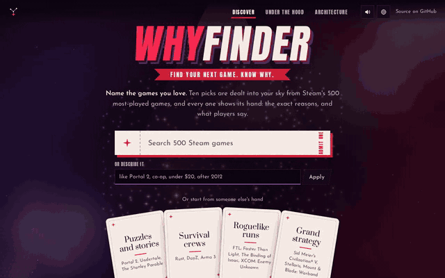

<p align="center">
  
</p>

<h1 align="center">Whyfinder</h1>
<p align="center"><b>Find your next game. Know why.</b></p>

<p align="center">
  <a href="https://github.com/robertgeraldsenasin/whyfinder/actions/workflows/ci.yml"></a>
  
  
</p>

Whyfinder recommends Steam games and shows, in a form you can check, **why** it picked each one.
Every reason is the model's actual reason, computed exactly, and CI proves every change keeps it that
way.

> **Live demo:** <https://robertgeraldsenasin.github.io/whyfinder/>: the glass-box engine runs in your
> browser on the 500 most-played games; *Under the hood* replays every step on your own picks.
>
<p align="center">
  
</p>

> **Status:** [v1.1.0](https://github.com/robertgeraldsenasin/whyfinder/releases/tag/v1.1.0) is out:
> the glass-box recommender with exact explanations and their checks, the quality gate, review
> retrieval, checked sentences (model-written ones opt-in, [ADR-0009](docs/decisions/ADR-0009-llm-runtime.md)),
> a REST API and the demo's live mode, scored once on a sealed test set (below;
> [model card](docs/model-card.md), [case study](docs/case-study.md), [paper draft](docs/paper/whyfinder.md)).
> What is still open: the known limitations in the [CHANGELOG](CHANGELOG.md) and the [roadmap](docs/plan/ROADMAP.md).

## How it works

| Layer | What it does | Spec |
| --- | --- | --- |
| **Glass-box blend** | EASE^R (closed-form item-item model) + Personalized PageRank over a game–tag–developer–co-play graph, blended into one item-item matrix | [04 §A2–A5](docs/spec/04_ALGORITHMS.md) |
| **Exact reasons** | Both models are additive over your history, so "42% from Dead Cells" is exact, and the smallest set of your games that removes a pick is found by re-scoring, not guessing | [05](docs/spec/05_EXPLAINABILITY.md) |
| **Variety** | DPP greedy MAP re-ranking keeps the top 10 from being ten copies of one game; picks kept for variety say so | [04 §A6](docs/spec/04_ALGORITHMS.md) |
| **Grounded words** | Hybrid BM25 + dense retrieval (hand-written HNSW) over reviews; a local LLM may only voice the exact reasons; a claim checker rejects anything unverifiable | [06](docs/spec/06_RAG.md) |
| **The rival** | iALS, a latent-factor model the glass-box blend must match | [04 §A3](docs/spec/04_ALGORITHMS.md) |
| **Gates** | Paired-bootstrap non-inferiority on ranking, explanation and RAG metrics for every PR; a sealed test set scored only at release | [07](docs/spec/07_EVALUATION.md) |
| **Live demo** | The same glass-box engine, ported to TypeScript and golden-matched to Python, runs in your browser on a 500-game slice: watch every step, from your history to the reasons | [ADR-0015](docs/decisions/ADR-0015-live-engine-demo.md) |

Architecture (C4 diagrams): [docs/spec/08_ARCHITECTURE.md](docs/spec/08_ARCHITECTURE.md).
Design language ("Unmasked"): [docs/spec/11_DESIGN_SYSTEM.md](docs/spec/11_DESIGN_SYSTEM.md).
Decisions: [docs/decisions/](docs/decisions/README.md).

## Quick start

```bash
uv sync --group dev        # Python 3.12+
make verify                # lint, format, types, import boundaries, tests
uv run whyfinder --help    # data pipeline and exports
cd web && npm ci && npm test && npm run dev   # browser engine vs Python goldens, then the demo
```

`uv run dvc repro` rebuilds the data pipeline and the validation numbers from the raw files; the
test-set numbers come only from `release.yml`, the one place the sealed split is read.

### The API

```bash
uv sync --group serve
uv run whyfinder serve run          # http://127.0.0.1:8000/docs (indexing reviews takes ~20 s)
docker run -p 8000:8000 ghcr.io/robertgeraldsenasin/whyfinder-api
```

```bash
curl -s localhost:8000/recommend -H 'content-type: application/json' \
  -d '{"query": "like Portal 2, co-op, under $20"}'
curl -s localhost:8000/explain -H 'content-type: application/json' \
  -d '{"liked_game_ids": ["620", "49520", "500"], "game_id": "440"}'
```

`/explain` returns the exact attributions, the counterfactual, graph paths and checked sentences,
some quoting players' reviews of the pick. With the API running, open the demo with
`?api=http://localhost:8000` and the last step of Under the hood shows the API's sentences for the
same pick beside the browser's. Endpoints, errors and limits:
[docs/spec/12_API.md](docs/spec/12_API.md); the OpenAPI document is [docs/openapi.json](docs/openapi.json).

## Results

The sealed test split is read only by `release.yml`; the tables below are generated from what it
wrote to [`results/`](results/). Popularity is hard to beat at the very top of a time-split list:
Whyfinder matches it on NDCG@10 and beats it on Recall@20 while covering 30% of the catalogue
against its 0.7%. The ADR-0006 targets, including the one missed, are in the second table.

<!-- results:start -->
| Model | coverage_at_10 | ild_at_10 | mrr | ndcg_at_10 | recall_at_20 |
| --- | --- | --- | --- | --- | --- |
| blend | 0.2983 [0.2983, 0.2983] | 0.7774 [0.7766, 0.7783] | 0.0605 [0.0580, 0.0631] | 0.0456 [0.0437, 0.0477] | 0.1196 [0.1157, 0.1236] |
| ease | 0.2214 [0.2214, 0.2214] | 0.7815 [0.7807, 0.7822] | 0.0600 [0.0575, 0.0625] | 0.0452 [0.0434, 0.0473] | 0.1189 [0.1150, 0.1229] |
| ials | 0.1259 [0.1259, 0.1259] | 0.7900 [0.7891, 0.7908] | 0.0420 [0.0400, 0.0442] | 0.0321 [0.0305, 0.0338] | 0.0826 [0.0794, 0.0859] |
| itemknn | 0.2405 [0.2405, 0.2405] | 0.7762 [0.7754, 0.7770] | 0.0582 [0.0556, 0.0609] | 0.0420 [0.0402, 0.0440] | 0.0976 [0.0941, 0.1012] |
| popularity | 0.0074 [0.0074, 0.0074] | 0.7375 [0.7371, 0.7378] | 0.0636 [0.0609, 0.0664] | 0.0454 [0.0433, 0.0474] | 0.1075 [0.1038, 0.1115] |
| ppr | 0.6208 [0.6208, 0.6208] | 0.7277 [0.7261, 0.7291] | 0.0444 [0.0421, 0.0466] | 0.0313 [0.0297, 0.0329] | 0.0771 [0.0741, 0.0804] |
| whyfinder | 0.2986 [0.2986, 0.2986] | 0.8280 [0.8275, 0.8286] | 0.0600 [0.0575, 0.0626] | 0.0447 [0.0428, 0.0467] | 0.1194 [0.1155, 0.1235] |

_Sealed test set, 95% bootstrap intervals._
<!-- results:end -->

<!-- targets:start -->
| Target (ADR-0006) | Result | Evidence |
| --- | --- | --- |
| Blend non-inferior to iALS on NDCG@10 (δ = 0.005) | met | 0.0456 vs 0.0321, Δ +0.0135 (95% CI +0.0118, +0.0153), p = 0.000 |
| Whyfinder beats popularity on NDCG@10 (p < 0.05, Holm over two) | **not met** | 0.0447 vs 0.0454, Δ -0.0007 (95% CI -0.0026, +0.0011), p = 0.777 |
| Whyfinder beats popularity on Recall@20 (p < 0.05, Holm over two) | met | 0.1194 vs 0.1075, Δ +0.0119 (95% CI +0.0078, +0.0159), p = 0.000 |
| DPP closes ≥ 10% of the ILD@10 headroom at an NDCG@10 cost ≤ 0.005 | met | ILD@10 0.7774 → 0.8280, 22.7% of the headroom; NDCG@10 0.0447 vs 0.0456, Δ -0.0010 (95% CI -0.0016, -0.0003), p = 0.000 |
| Attributions sum to the score (share of picks) | met | 1.0000 |
| Counterfactuals valid (share of picks) | met | 1.0000 |
| Deletion test ≥ 95% of users | met | 0.9680 |

_Sealed test set, 20,000 users, paired bootstrap._
<!-- targets:end -->

**Evidence:** the gate failing a deliberately worse model ([docs/evidence/gate-proof.md](docs/evidence/gate-proof.md)),
the hand-written HNSW against hnswlib ([docs/evidence/hnsw-bench.md](docs/evidence/hnsw-bench.md)),
validation tuning ([results/validation/](results/validation/)).

## Data and citation

Steam data from the UCSD McAuley Lab (<https://cseweb.ucsd.edu/~jmcauley/datasets.html>), downloaded by
script and never redistributed. Please cite the dataset papers listed in [CITATION.cff](CITATION.cff).

## License

MIT © 2026 Robert Gerald Senasin
