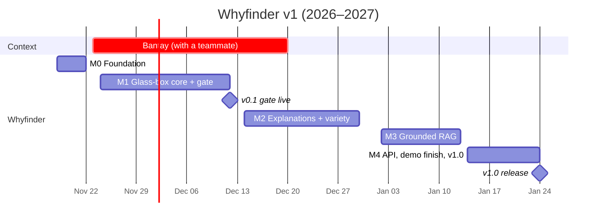

# Roadmap

Five milestones, about 26 focused days of issues (`docs/plan/BACKLOG.csv`) plus a little buffer, ending with **v1.0 on January 24, 2027** if M0 starts
November 18 and work runs part-time (~2 days/week) during Bantay (Nov 23 – Dec 20). Every milestone
ends with a tagged release that is useful on its own: if time runs out, something real still ships.

**Demo track (ADR-0015).** The star-atlas demo is built alongside the core, not after it: each
algorithm lands in Python and in the browser engine in the same PR, golden-matched, so the live demo on
GitHub Pages grows with every milestone.

## M0 · Foundation (3 days) → `v0.0.1`

- [x] Repo from this kickoff pack; branch protection (set in Settings); labels, milestones and issues via `scripts/bootstrap_github.py`
- [x] `uv` project; ruff, mypy, pytest, import-linter, pre-commit; `ci.yml` green (NFR-05)
- [x] `whyfinder data fetch` with checksums; confirm Version 2 date/hours coverage (FR-01, ADR-0002)
- [x] DVC stages `parse → clean → kcore → split` with Pandera contracts (FR-02, FR-03)
- [x] Publish the CI subsample `data-ci-v1`; record `data/stats.json`
- [x] Finalise ADR-0002, ADR-0003
- [x] Demo track: demo data slice export (`whyfinder export demo`); demo shell (Vite + Svelte + TypeScript, Star Atlas themes, fonts, star map, architecture view) deployed to Pages (FR-22, ADR-0015, ADR-0016)

## M1 · Glass-box core + gate (7 days) → `v0.1.0` (first resume bullet)

- [x] Popularity, item-kNN (FR-04)
- [x] EASE^R with item cap (FR-05, ADR-0004)
- [x] Game graph + PPR forward push + Π (FR-06, FR-07)
- [x] Blend M, scoring, β tuning (FR-08): β = 0.25 on full-data validation (`results/validation/`)
- [x] iALS rival with oracle test (FR-09): dense normal equations and objective as oracles; the `implicit` comparison waits for the dev dependency
- [x] Metrics, per-user arrays, bootstrap, Holm; `whyfinder eval` (FR-19)
- [x] `quality-gate.yml` live with PR comment (FR-20)
- [x] Prove the gate with a deliberately worse PR and keep the record (`docs/evidence/gate-proof.md`, PR #74)
- [x] README tables from `results/` (v0.2.0); ADR-0006 fixed from baselines
- [ ] Demo track: EASE^R, graph + PPR push and the blend land in Python and TypeScript together, golden-matched; "Under the hood" steps 1–4 live

## M2 · Explanations + variety (5 days) → `v0.2.0`

- [ ] Exact attributions with EASE/PPR split (FR-10)
- [x] Counterfactuals: live greedy + offline exact; iALS Sherman–Morrison variant (FR-11, ADR-0012)
- [ ] DPP re-ranking + "kept for variety" flag (FR-12)
- [ ] Graph paths (FR-13)
- [x] Explanation checks in the gate (deletion, validity, minimality gap, sanity check)
- [ ] Demo track: attributions, counterfactuals and DPP live in the browser; Discover view with the why panel; "Under the hood" steps 5–7

## M3 · Grounded RAG (6 days) → `v0.3.0`

- [x] Review sample, chunking, BM25 (FR-14): over the demo's review export; the full-corpus DVC `index` stage is still to do
- [x] Embeddings + hand-written HNSW + RRF (FR-15, ADR-0010): LSA vectors; benchmarked against hnswlib (`docs/evidence/hnsw-bench.md`)
- [ ] Label 150 (pick, aspect) queries with a written guide (~1 day)
- [x] Ollama generation, claim schema, checker, fallback, cache (FR-16, FR-17, ADR-0009): pinned decoding, llama3.2:3b keeps 99.4% of claims; opt-in
- [x] Natural-language queries and filters (FR-18, FR-23)
- [ ] Entailment + attribution-agreement metrics; the unconstrained-LLM ablation

## M4 · API, demo finish, v1.0 (6 days) → `v1.0.0`

- [x] FastAPI + OpenAPI + Schemathesis; Docker image to GHCR (FR-21)
- [ ] Demo finish: natural-language query bar, filters, optional API mode, "Under the hood" step 8 (grounded words), final polish (FR-22, 11_DESIGN_SYSTEM)
- [ ] `pages.yml` deploy with health check; ADR-0008
- [x] Sealed test-set results ✓ (v0.2.0), model card ✓, portfolio case study ✓ (`docs/case-study.md`), demo GIF ✓, paper draft ✓ (`docs/paper/whyfinder.md`)

## Definition of done

- **Issue:** its acceptance criterion passes in CI; tests include a failure path; `make verify` passes;
  docs/ADR updated if a decision changed; no new warnings.
- **Milestone:** gates green on `main`; tagged release with notes; README + CHANGELOG updated; a GIF or
  screenshot of what's new.
