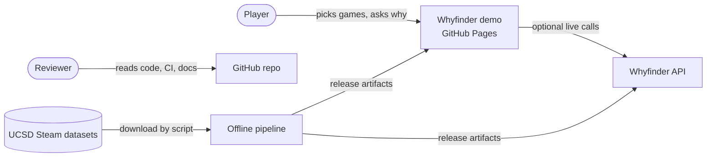
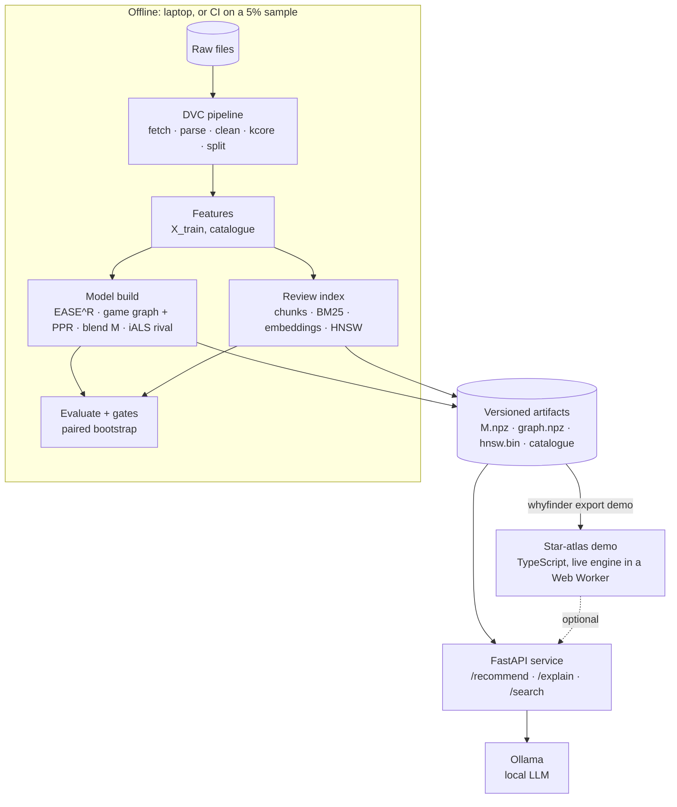
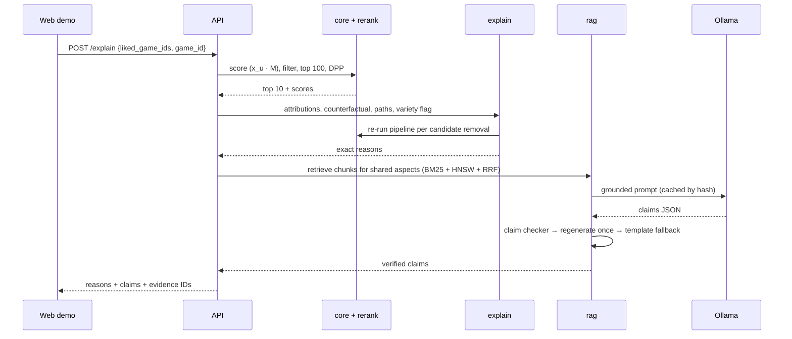

# 08 · Architecture

One Python package with strict internal layers, an offline pipeline that produces versioned
artifacts, a thin API that only reads them, and a static TypeScript demo. The diagrams follow the C4
model (context → containers → components) and render on GitHub.

## C1 · Context



## C2 · Containers



## C3 · Components (package `whyfinder`)

| Package | Responsibility | May import | Never imports |
| --- | --- | --- | --- |
| `data` | fetch, parse, clean, contracts, split | numpy, pandas, pandera | `serve` |
| `core` | popularity, item-kNN, EASE^R, iALS, blend scoring | numpy, scipy | anything else in whyfinder |
| `graph` | game graph build, PPR forward push, Π | numpy, scipy, `core` (types) | `serve`, `rag` |
| `rerank` | DPP greedy MAP, filters | numpy, `core` (types) | `serve` |
| `explain` | attributions, counterfactuals, paths, variety flag | `core`, `graph`, `rerank` | `rag`, `serve` |
| `rag` | chunking, BM25, HNSW, RRF, generation, claim checker, cache | `explain` (types), `core` (types) | `serve`, `eval` |
| `eval` | metrics, bootstrap, gates, reports | everything except `serve` | `serve` |
| `serve` | FastAPI app, Pydantic schemas | everything except `eval` | (nothing imports it) |
| `cli` | Typer entry point | everything | — |

Enforced by **import-linter** contracts in `pyproject.toml`, checked in CI.

## Request flow: `/explain`



## Repository layout

```
whyfinder/
├─ src/whyfinder/{data,core,graph,rerank,explain,rag,eval,serve}/, cli.py
├─ tests/{unit,property,golden,contract}/
├─ web/                 Star-atlas demo (Vite + Svelte + TypeScript), live engine on an exported slice
├─ docs/{spec,decisions,plan,guide,design}/
├─ results/             metrics JSON the README tables are generated from
├─ scripts/             bootstrap_github.py, gen_readme_tables.py
├─ docker/              Dockerfile.api (multi-stage, non-root)
├─ .github/             workflows, issue and PR templates, CODEOWNERS, dependabot
├─ dvc.yaml  params.yaml  pyproject.toml  uv.lock  Makefile  CITATION.cff
```

## Determinism rules

- No wall-clock time or unseeded randomness in `core`, `graph`, `rerank`, `explain`, `eval`: seeds are
  passed in; clocks are injected.
- Every tie broken by game ID.
- Functions are pure and never mutate inputs; arrays passed in are treated as read-only.
